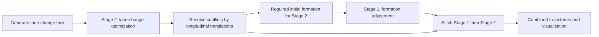

# Cooperative Lane Changes for Connected and Automated Vehicles

**Plan the lane changes, arrange the formation, and stitch the two motion stages.** This MATLAB research implementation accompanies:

> Bai Li, Youmin Zhang, Yiheng Feng, Yue Zhang, Yuming Ge, and Zhijiang Shao, “Balancing Computation Speed and Quality: A Decentralized Motion Planning Method for Cooperative Lane Changes of Connected and Automated Vehicles,” *IEEE Transactions on Intelligent Vehicles*, 3(3), 340–350, 2018. [Paper / DOI](https://doi.org/10.1109/TIV.2018.2843159).

## What the example does

The example assigns initial and destination lanes to a group of vehicles, computes lane-change trajectories, adjusts their longitudinal spacing to avoid conflicts, and computes the preceding formation-adjustment stage. The two stages are then combined into a multi-vehicle maneuver.

The **computation order differs from the driving order**: Stage 2 is planned first because its required formation determines the target of Stage 1. The executed maneuver follows Stage 1 and then Stage 2.



## Requirements and quick start

- MATLAB on **Windows**. Some numerical and visualization components are distributed as MATLAB P-code.
- A usable **AMPL** installation and an **AMPL-compatible IPOPT** solver, with their matching runtime DLLs. Windows executables are included; third-party licensing and compatibility still apply.
- A writable repository directory: MATLAB and AMPL exchange local parameter, initialization, status, and trajectory files.

Open MATLAB in the repository root and run the entry point with its exact filename:

```matlab
cd('C:/path/to/MultiCavLaneChange');
rng(1);                  % Optional: repeat the same randomized task
RunMe;
```

Keep the executables and DLLs together. If an external installation is used, make it visible to MATLAB's system commands, for example:

```matlab
setenv('PATH', ['C:\path\to\ampl', pathsep, getenv('PATH')]);
```

The script leaves `coop_traj_final` in the workspace and calls the protected `dsa.p` renderer. `tf1` and `tf2` are stage durations; `gross_time = tf1 + tf2` is the **maneuver duration**, not CPU time. Solver and graphics runtimes depend on the generated task and local installation.

The distribution is designed around its Windows executables and P-code; a native Linux/macOS workflow is not supplied here.

## Configuration

Edit `InitParams.m` before running:

| Parameter | Default | Meaning |
| --- | ---: | --- |
| `params.user.num_cars` | 10 | Number of cooperating vehicles |
| `params.user.num_lanes` | 3 | Available lanes |
| `params.user.v_std` | 10 m/s | Nominal longitudinal speed |
| `params.user.nfe_stage1` | 300 | Stage 1 discretization points |
| `params.user.nfe_stage2` | 100 | Stage 2 discretization points |
| `params.planner.ds` | 0.5 m | Longitudinal translation increment |
| `params.vehicle.vmax` | 12 m/s | Speed bound |
| `params.vehicle.amax` | 0.5 m/s² | Acceleration bound |
| `params.vehicle.phymax` | 0.6 rad | Steering-angle bound |
| `params.vehicle.wmax` | 0.25 rad/s | Steering-rate bound |

The vehicle has a 2.8 m wheelbase, 0.96 m front overhang, 0.929 m rear overhang, and 1.942 m width. `GenerateTask.m` uses 3.75 m lane-center spacing and random lane assignments/gaps. Change that function when introducing a prescribed traffic scenario; changing the random seed alone does not prescribe the task.

## Function map

| File | Responsibility |
| --- | --- |
| `RunMe.m` | Orchestrate task generation, both optimizations, spacing adjustment, stitching, and visualization. |
| `InitParams.m` | Define vehicle, planner, and experiment settings in global `params`. |
| `GenerateTask.m` | Generate initial/destination lanes and write the `task` data file. |
| `GenerateInitialGuessForStage2.m` | Build initial lane-change state/control profiles. |
| `WriteInitialGuessForStage2.p`, `WriteParamsForStage2.m` | Prepare Stage 2 solver inputs. |
| `SolveNlpAtStage2.p`, `LoadOptimumForStage2.p` | Invoke and load the Stage 2 nonlinear optimization. |
| `ProduceDelayList.m` | Process vehicles in descending initial longitudinal position and translate conflicting trajectories in increments of `ds`. |
| `IsCurTrajValidWithFixedPart.p` | Test a candidate against already accepted vehicle trajectories. |
| `WriteRelativeFormationInfoForStage1.m` | Write the relative formation required by the adjusted Stage 2 trajectories. |
| `GenerateInitialGuessForStage1.m` | Build the formation-adjustment initialization. |
| `WriteInitialGuessForStage1.p`, `WriteParamsForStage1.m` | Prepare Stage 1 solver inputs. |
| `SolveNlpAtStage1.p`, `LoadOptimumForStage1.p` | Invoke and load the Stage 1 nonlinear optimization. |
| `StitchTwoStages.p` | Combine the two stages in execution order. |
| `CreateVehiclePolygon.m` | Compute the rectangular vehicle footprint from its rear-axle pose. |
| `dsa.p` | Protected visualization entry point called by `RunMe`. |

Files ending in `.p` are executable MATLAB P-code, not missing `.m` files. The table describes their calling interfaces; their implementations are not distributed as readable source.

## Citation

```bibtex
@article{Li2018CooperativeLaneChanges,
  author = {Bai Li and Youmin Zhang and Yiheng Feng and Yue Zhang
            and Yuming Ge and Zhijiang Shao},
  title = {Balancing Computation Speed and Quality: A Decentralized Motion
           Planning Method for Cooperative Lane Changes of Connected
           and Automated Vehicles},
  journal = {IEEE Transactions on Intelligent Vehicles},
  volume = {3}, number = {3}, pages = {340--350}, year = {2018},
  doi = {10.1109/TIV.2018.2843159}
}
```

## License

See [LICENSE](LICENSE) for the repository's LGPL-2.1 terms. Bundled solvers and runtime libraries retain their own licenses.
